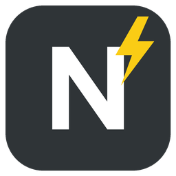

# NodeVX

Espacio de trabajo de notas por bloques (al estilo de las wikis tipo Notion) con un **bloc de notas rápidas** que se guarda localmente como borrador. Funciona sin internet y sin cuentas: todo vive en tu equipo.



## Funciones

**Páginas y editor de bloques**
- Páginas anidadas en la barra lateral (arrastra para reordenar o anidar), favoritos, papelera con restaurar/eliminar.
- Icono (emoji) y portada (degradado, URL o imagen local) por página.
- Menú `/` con: texto, encabezados 1-3, viñetas, lista numerada, tareas, desplegables, cita, destacado, código, divisor, subpágina, imagen y fecha.
- Atajos Markdown: `#`, `##`, `###`, `-`, `1.`, `[]`, `[x]`, `>` (desplegable), `"` (cita), `!` (destacado), ` ``` ` (código), `---`.
- Barra de formato al seleccionar texto: negrita, cursiva, subrayado, tachado, código, enlace, colores y resaltado.
- Colores de texto y fondo por bloque, sangrías con Tab, arrastrar bloques (también a otra página de la barra lateral), duplicar, mover.
- Pegar texto Markdown lo convierte en bloques; pegar una imagen crea un bloque de imagen.
- Búsqueda global (`Ctrl+K`), estilos de página (serif/mono, texto pequeño, ancho completo), exportar a Markdown, imprimir/PDF.
- Tema claro / oscuro / sistema.

**⚡ Notas rápidas (borrador local)**
- Panel lateral que se abre con `Alt+N` o el botón **⚡ Borrador**.
- Guardado automático al instante en `drafts.json` (más una copia espejo en el almacenamiento del navegador).
- Varios borradores en pestañas, contador de palabras, copiar, eliminar.
- **Convertir en página**: la primera línea pasa a ser el título y el resto se convierte en bloques (entiende Markdown).

## Lanzador para Windows (`NodeVX.exe`)

Un único ejecutable (~7 MB, sin instalación) que:
1. Lleva la interfaz incrustada y levanta un servidor solo en `127.0.0.1` (no accesible desde la red).
2. Abre una ventana de aplicación propia con **Microsoft Edge** (incluido en Windows 10/11) o Chrome/Brave en modo `--app`. Si no hay ninguno, usa el navegador predeterminado.
3. Guarda los datos en `%APPDATA%\NodeVX`:
   - `workspace.json` – páginas
   - `drafts.json` – notas rápidas
   - `backups\` – una copia diaria de cada archivo (se conservan 15)
4. Se cierra solo al cerrar la ventana. Si lo abres dos veces, abre otra ventana sobre la misma instancia.

Opciones: `NodeVX.exe --data D:\MisNotas` (otra carpeta de datos), `--port 47821`, `--no-browser`.

> Windows SmartScreen puede avisar la primera vez porque el ejecutable no está firmado: *Más información → Ejecutar de todas formas*.

### Compilar

Requiere [Go 1.22+](https://go.dev/dl/).

```bash
./build.sh        # Linux / macOS / Git Bash → dist/NodeVX.exe
```

```bat
build.bat         :: Windows (cmd)
```

Cada push compila el `.exe` en GitHub Actions (artefacto **NodeVX-windows-x64**); al crear un tag `v*` se adjunta a una release.

### Desarrollo

```bash
go run . --no-browser --data ./datos-dev   # abre http://127.0.0.1:47821
```

También puedes abrir `web/index.html` directamente: en ese modo los datos se guardan en el `localStorage` del navegador.

## Estructura

```
main.go               servidor local, API de guardado, copias de seguridad, cierre automático
browser_windows.go    abre la ventana con Edge/Chrome y muestra errores nativos
browser_other.go      equivalente para Linux/macOS (desarrollo)
web/                  interfaz (HTML/CSS/JS sin dependencias, incrustada en el .exe)
assets/               icono y manifiesto de Windows
tools/genicon/        script que genera el icono
```
